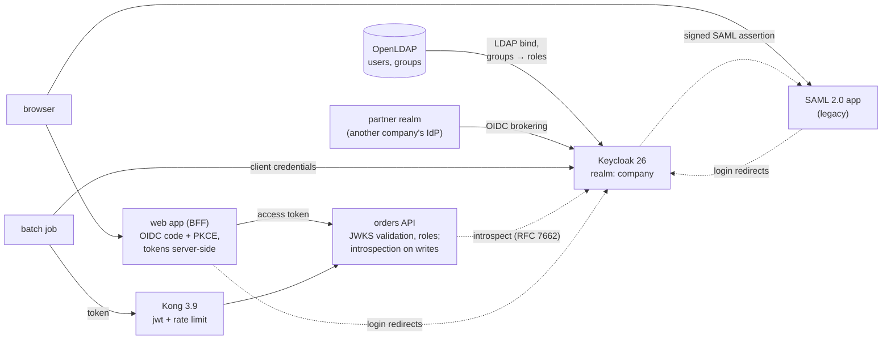

# identity-federation-lab: architecture

Protocol details and decisions are in [`design.md`](design.md), and troubleshooting is in [`runbook.md`](runbook.md). This page is the system view.

## 1. Context

A company has one user directory (LDAP) and many applications, of every age and kind:
- a modern web app;
- APIs called by people and by batch jobs;
- a legacy app that only speaks SAML;
- a partner company whose staff need access.

The lab shows each of these trusting **one** identity provider, and tests every flow end to end, including the attacks each one must refuse and what happens when someone leaves.

## 2. Trust decisions, per component

| Component | Trusts | Checks |
|---|---|---|
| Keycloak | LDAP for passwords and groups (read-only federation); the partner IdP for partner users | LDAP bind; partner users get a fixed `orders-reader` role from an IdP mapper, never the partner's own role claims |
| Web app (backend-for-frontend) | Keycloak's ID token | `state` (CSRF), `nonce` (replay), PKCE, ID token signature/`iss`/`aud`/`exp`. The browser holds only an opaque session cookie, never tokens. |
| Orders API | Tokens signed by the realm key | Signature from the JWKS by `kid` (refetched on an unknown `kid`, for key rotation), RS256 only (no `none`, no HS256 confusion), `iss`, `aud=orders-api`, `exp` with 30 s leeway, role per endpoint; **writes additionally introspected** |
| Kong | The realm's public key | Signature and `exp` at the edge, plus a rate limit. Authorisation stays in the API. |
| SAML app | The IdP's signing certificate | Signature, audience, recipient, `InResponseTo`, time window, replay cache, signature-wrapping defences, no XXE |

## 3. Revocation: the gap stateless tokens leave

- **The gap:** a JWT access token is valid until it expires, five minutes here. Signing out, disabling a user, or an employee leaving doesn't change a token that is already issued, so local validation keeps accepting it.
- **How the lab closes it:**
  - **Reads:** local JWT checks only. They're fast and don't call the IdP, but they accept up to one token lifetime of staleness.
  - **Writes:** after local checks, the API asks Keycloak's introspection endpoint (RFC 7662), authenticated as the confidential `orders-api` client, whether the token is still active. A revoked session, or a disabled or deleted user, gives `active: false`, so the request is refused with 401. If the IdP can't answer, the write is refused too: for a write, "can't check" must not mean "allowed".
- **The leaver drill** (end of `tests/e2e.py`): alice signs in and creates an order. An administrator revokes all her sessions, as offboarding or "sign out everywhere" does. Her web session still holds the access token. Her next write is refused at once, and her next read still succeeds, which is the documented gap. The drill reports how long the token stays valid.
- **The trade-off:** introspection costs one IdP round trip per write and makes the IdP a dependency of every write. That is why it isn't applied to reads by default (`INTROSPECT=all` does). Other options: shorter token lifetimes, Keycloak back-channel logout to the apps, or a revocation list pushed to resource servers.

## 4. Keys and rotation

Keycloak publishes every active public key in its JWKS. Resource servers select the key by `kid` and refetch on an unknown one, so a new key is picked up without a restart. Kong OSS's jwt plugin holds one key per issuer: rotation means re-rendering its config and reloading, with a short window where old-key tokens fail at the edge. The runbook gives the zero-downtime order: add the new key, let tokens roll over, then retire the old key.

## 5. Testing

| Level | What |
|---|---|
| Unit (24) | The API's token checks (wrong key, audience, issuer, expiry, leeway, `alg=none`, HS256 confusion), introspection on writes but not reads, refusing a write when the IdP is down; the SAML validator (forged, wrong signer, unsigned, wrapping, audience, expiry, unsolicited, replay, XXE) |
| End to end (Compose, CI) | Every flow above for real, the attacks each must refuse, and the leaver drill |

## 6. Production differences

TLS everywhere, including LDAPS. Keycloak in production mode with a real database, clustered. Secrets from a vault, not the realm file. Shared session storage for the apps. SCIM, or an HR-driven job, for provisioning and deprovisioning. Kong replaced or extended with a JWKS-aware plugin, so key rotation needs no reload. The list is in `design.md`.
